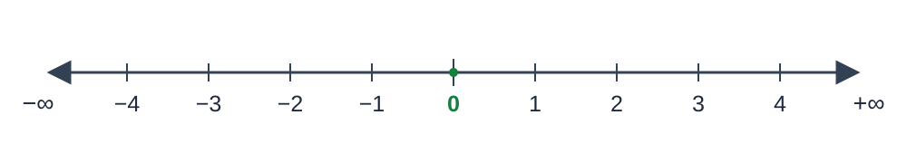
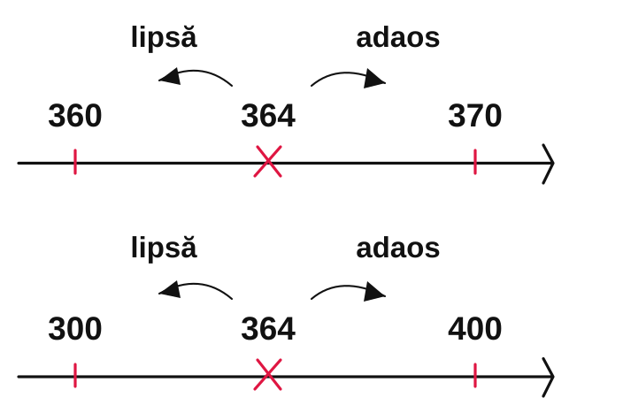
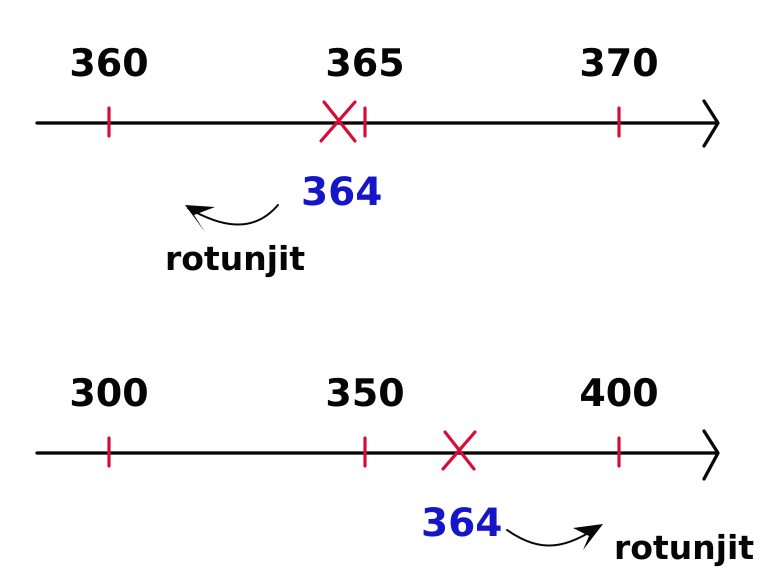

## Axa numerelor

Cand discutam de numere in general, indiferent ca sunt intregi rationale sau irationale, <u>ele trebuiesc vazute intotdeauna in contextul axei numerelor</u>.

{ width="600" align="center" }

## Aproximari

Aproximarile se aplica in functie de ordin (zeci, sute, mii, etc.).  
Tipuri de aproximari:

* <u>***prin lipsa***</u>, inseamna a face nule toate cifrele de dupa acel ordin, adica numarul devine mai mic.
* <u>***prin adaos***</u>, inseamna a face nule cifrele de dupa, dar maresti cu 1 ordinul respectiv, adica numarul devine mai mare.
* <u>***prin rotunjire***</u>, in functie de cifra 5
    * daca urmeaza cifra   <5: ordinul ramane la fel.
    * daca urmeaza cifra >= 5: maresti ordinul cu 1.

Exemplu:  
<u>Aproximare</u> la zeci si la sute:
{ width="600" align="center" }

Exemplu:  
<u>Rotunjire</u> la zeci si sute:
{ width="600" align="center" }

Exercitiu:  
Aproximati urmatoarele numere: 2749, 555, 1236.  

Raspunsuri:
=== "Prin lipsa"

    ??? example "2749"

        | Ordin    | Valoare |
        | :------: | ------: |
        | la zeci: | 2740    |
        | la sute: | 2700    |
        | la mii:  | 2000    |

    ??? example "555"

        | Ordin    | Valoare |
        | :------- | ------: |
        | la zeci: | 550     |
        | la sute: | 500     |
        | la mii:  | 0       |

    ??? example "1236"

        | Ordin    | Valoare |
        | :------: | ------: |
        | la zeci: | 1230    |
        | la sute: | 1200    |
        | la mii:  | 1000    |

=== "Prin adaos"

    ??? example "2749"

        | Ordin    | Valoare |
        | :------: | ------: |
        | la zeci: | 2750    |
        | la sute: | 2800    |
        | la mii:  | 3000    |

    ??? example "555"

        | Ordin    | Valoare |
        | :------- | ------: |
        | la zeci: | 560     |
        | la sute: | 600     |
        | la mii:  | 1000    |

    ??? example "1236"

        | Ordin    | Valoare |
        | :------: | ------: |
        | la zeci: | 1240    |
        | la sute: | 1300    |
        | la mii:  | 2000    |

=== "Prin rotunjire"

    ??? example "2749"

        | Ordin    | Valoare |
        | :------: | ------: |
        | la zeci: | 2750    |
        | la sute: | 2700    |
        | la mii:  | 3000    |

    ??? example "555"

        | Ordin    | Valoare |
        | :------- | ------: |
        | la zeci: | 560     |
        | la sute: | 600     |
        | la mii:  | 1000    |

    ??? example "1236"

        | Ordin    | Valoare |
        | :------: | ------: |
        | la zeci: | 1240    |
        | la sute: | 1200    |
        | la mii:  | 1000    |

